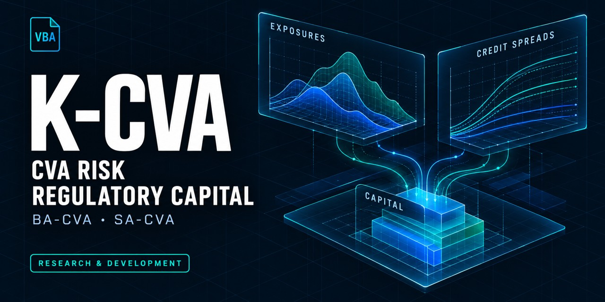

<div align="center">

# K-CVA

**Regulatory capital for credit valuation adjustment risk**

An Excel/VBA project for transparent methods and traceable CVA capital calculations.

[](#project-status)
[](INSTALLATION.md)
[](docs/methodology/README.md)
[](LICENSE)

**[Getting started](#getting-started) · [Methodology](docs/methodology/README.md) · [Project status](#project-status) · [Documentation](#documents)**



*An independent project by [Daniele Penza](https://github.com/danielep71).*

</div>

> [!IMPORTANT]
> **Repository setup only.** There is no calculation engine, public API,
> workbook or validated method yet. Nothing here should be used to compute
> capital. Repository CI checks infrastructure; it does not establish numerical
> correctness or regulatory compliance.

## Purpose and scope

K-CVA is intended to calculate own funds requirements for CVA risk under the
**EU Capital Requirements Regulation, as amended by CRR3**, using exposures,
effective maturities and hedges supplied by the caller.

| Dimension | Project direction |
| --- | --- |
| First approach | **BA-CVA** — basic approach to CVA risk |
| Subsequent approach | **SA-CVA** — standardised approach to CVA risk |
| Intended application | **Excel/VBA**, with explicit inputs and traceable outputs |
| Inputs | Supplied exposure values, effective maturities and hedges |
| Outside scope | Economic or accounting CVA, exposure simulation and a parallel Python product |

These are scope decisions, not implemented capabilities.
See the [decision register](docs/DECISIONS.md) and
[methodology guide](docs/methodology/README.md) for the controlling details.

## Project status

| Component | Available today | Remaining work |
| --- | --- | --- |
| Repository infrastructure | CI, issue policy, static checks and development conventions | Ongoing maintenance and milestone closeout |
| Methodology | Regulatory basis, source copy, BA-CVA input definitions and test-case format | Calculation implementation and numerical validation |
| VBA regression harness | Neutral example suite and evidence tooling | Compilation and execution in Excel under [#11](https://github.com/danielep71/K-CVA/issues/11) |
| Calculation product | No engine, public API or workbook | Future implementation, testing and release |

**No version, tag or workbook has been released.** The current milestone is
**v0.1.0 — Repo setup**. Follow the [closeout checklist](docs/CLOSEOUT.md),
[change history](CHANGELOG.md) and [release procedure](RELEASING.md).

## Getting started

Choose the route that fits your purpose:

| I want to… | Start here |
| --- | --- |
| Understand the intended calculation | [Methodology](docs/methodology/README.md) and [scope decisions](docs/DECISIONS.md) |
| Set up a development environment | [Installation guide](INSTALLATION.md) |
| Explore the test scaffold | [Tests and evidence](tests/README.md) |
| Contribute or report an issue | [Contribution guide](CONTRIBUTING.md) |
| Review governance and limitations | [Governance](docs/GOVERNANCE.md) and [security policy](SECURITY.md) |

For development:

1. [Obtain the source](INSTALLATION.md#obtain-an-exact-source-revision) and
   switch to `release/0.1.0`.
2. Install Git, Python and Node.js using the
   [developer setup](INSTALLATION.md#developer-setup), then run:

   ```bash
   python tools/check_repository.py
   ```

3. To explore the VBA harness, follow
   [importing VBA into Excel](INSTALLATION.md#importing-vba-into-excel) and
   [running the harness](INSTALLATION.md#running-the-harness), then run
   `TEST_Examples.RunExampleTests`.
4. Read [CONTRIBUTING.md](CONTRIBUTING.md) before proposing a change.

## What exists today

The repository checks cover tooling tests, label and issue-form configuration,
numerical test-case **format**, exported VBA static rules and workflows.
They read files only: they neither compile VBA nor test a CVA calculation.

The regression harness exercises a neutral example suite, with no CVA formula.
Its Excel execution remains unverified. The methodology documents retain the
regulatory source and describe the inputs and evidence expected for future work.

See [CI coverage](docs/CI.md), [tooling](tools/README.md) and
[test-case contracts](docs/methodology/TEST_CASES.md) for the precise boundaries.

## Documents

<details>
<summary><strong>Browse the complete documentation index</strong></summary>

| Document | Purpose |
| --- | --- |
| [docs/REPOSITORY_STRUCTURE.md](docs/REPOSITORY_STRUCTURE.md) | Layout, dependency direction, public API boundary, contracts |
| [docs/DECISIONS.md](docs/DECISIONS.md) | Scope, architecture and methodology decisions, open and closed |
| [docs/methodology/README.md](docs/methodology/README.md) | Regulatory basis, approaches, BA-CVA inputs, version applicability, source register, traceability |
| [docs/methodology/sources/README.md](docs/methodology/sources/README.md) | The copy of the CRR provisions relied on, with hashes and terms of use |
| [docs/methodology/TEST_CASES.md](docs/methodology/TEST_CASES.md) | Test-case files, tolerances, reference classes, completeness |
| [docs/VBA_HOUSE_STYLE.md](docs/VBA_HOUSE_STYLE.md) | VBA naming, contracts, errors, cleanup, encoding |
| [INSTALLATION.md](INSTALLATION.md) | Excel host, developer setup and evidence locations, importing and exporting the VBA source, running the harness |
| [tests/README.md](tests/README.md) | Test layout, the VBA harness and its log format |
| [CONTRIBUTING.md](CONTRIBUTING.md) | Reporting a problem with synthetic data; the development workflow; validation rules |
| [docs/GOVERNANCE.md](docs/GOVERNANCE.md) | Branches, integration, review, protection, issues |
| [docs/ISSUE_LABELS.md](docs/ISSUE_LABELS.md) | Issue labels, priorities and triage |
| [docs/CI.md](docs/CI.md), [tools/README.md](tools/README.md) | Repository checks, CI coverage and dependency updates |
| [SECURITY.md](SECURITY.md) | Reporting vulnerabilities privately; synthetic data only |
| [NOTICE.md](NOTICE.md), [LICENSE](LICENSE) | Copyright, provenance and the MPL-2.0 licence |
| [CHANGELOG.md](CHANGELOG.md), [RELEASING.md](RELEASING.md) | What changed, versions and the release procedure |
| [docs/CLOSEOUT.md](docs/CLOSEOUT.md) | The v0.1.0 closeout checklist and evidence index |

</details>

## Development and governance

Task branches start from `release/0.1.0`; task PRs target that branch.
Integration into `main` follows the [governance policy](docs/GOVERNANCE.md).
Changes are recorded under `[Unreleased]` in [CHANGELOG.md](CHANGELOG.md).
Publication requires a separate maintainer decision.

Use synthetic data in issues and test cases. Report vulnerabilities through the
[security policy](SECURITY.md). Code and documentation licensing and provenance
are recorded in [LICENSE](LICENSE) and [NOTICE.md](NOTICE.md).

---

<sub>Previously named MKT-K-CVA until 2026-10-24. GitHub redirects the old repository links.</sub>
